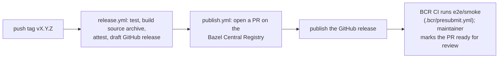

# Contributing to rules_lean

## Development setup

Install [Bazelisk](https://github.com/bazelbuild/bazelisk) and use it as `bazel`; it
reads `.bazelversion`. Nothing else is needed: the first build downloads Lean (about
600 MB) into Bazel's repository cache.

Put machine-local flags in `user.bazelrc` (ignored by git), for example a startup flag
your network needs.

## Tests

| What | Command | Expected |
|---|---|---|
| Rules, examples, version selection | `bazel test //...` | passes |
| Proof check catches holes | `bazel test //tests/negative:holes_proofs` | **fails**, naming `sorryAx` and `myAxiom` |
| Use from another module | `cd e2e/smoke && bazel test //...` | passes |
| Unknown Lean version | `cd e2e/bad_version && bazel build //...` | **fails** with a clear message |

CI ([`.github/workflows/ci.yml`](.github/workflows/ci.yml)) runs all four on Linux
(x86_64, aarch64), macOS (arm64, x86_64) and Windows, each with Bazel 7.4.1, 8.x and
9.x.

The directories under `e2e/` are separate Bazel modules (`.bazelignore` hides them
from `//...`). `e2e/smoke` is also the test module the Bazel Central Registry runs for
every release.

In Git Bash on Windows, set `MSYS_NO_PATHCONV=1` so labels like `//tests/...` are not
rewritten as paths.

## Adding a Lean version

Versions live in [`lean/private/versions.bzl`](lean/private/versions.bzl): for each
version, one `.tar.zst` archive and its sha256 per platform.

1. Take the asset names and checksums from the GitHub release API's `digest` field
   (GitHub computes it on upload; no need to download 3 GB of archives). For 4.35.0:

   ```sh
   gh api repos/leanprover/lean4/releases/tags/v4.35.0 \
     --jq '.assets[] | select(.name | endswith(".tar.zst")) | "\(.name) \(.digest)"'
   ```

   ```text
   lean-4.35.0-darwin.tar.zst sha256:0b43...
   lean-4.35.0-darwin_aarch64.tar.zst sha256:c0c6...
   lean-4.35.0-linux.tar.zst sha256:7289...
   lean-4.35.0-linux_aarch64.tar.zst sha256:c8f0...
   lean-4.35.0-windows.tar.zst sha256:893f...
   ```

2. Add an entry to `LEAN_VERSIONS`, dropping the `sha256:` prefix. Platform keys map
   to assets like this:

   | Key | Asset |
   |---|---|
   | `darwin_aarch64` | `lean-<v>-darwin_aarch64.tar.zst` |
   | `darwin_x86_64` | `lean-<v>-darwin.tar.zst` |
   | `linux_aarch64` | `lean-<v>-linux_aarch64.tar.zst` |
   | `linux_x86_64` | `lean-<v>-linux.tar.zst` |
   | `windows_x86_64` | `lean-<v>-windows.tar.zst` |

3. To make it the default, update `DEFAULT_LEAN_VERSION` and the version in the
   README, `examples`, `e2e/smoke/MODULE.bazel`, `e2e/greeting/MODULE.bazel` and the
   expected message in `e2e/bad_version` and `ci.yml`.

4. Run the tests above. CI downloads and exercises every platform's archive.

Never commit, mirror or attach a Lean archive anywhere in this repository or its
releases; see the README's Licensing section.

## Dependencies

Keep the module's dependencies minimal and permissively licensed (Apache 2.0, MIT,
BSD). Today they are `platforms` and `bazel_skylib`, both Apache 2.0.

## Releasing

Releases are cut by pushing a tag `vX.Y.Z` on `main`:



- The archive is `git archive` of the tag: sources only, no Lean binaries.
- [`.bcr/`](.bcr) holds the templates the BCR entry is generated from.
- One-time setup and the steps for each release are in
  [`.github/workflows/publish.yml`](.github/workflows/publish.yml).

## Commits

Small, logical commits with a message that explains why. Every change needs a test:
a rule change gets a target under `tests/` (or `e2e/` if it concerns use from another
module), an error message gets a check that it fires.
