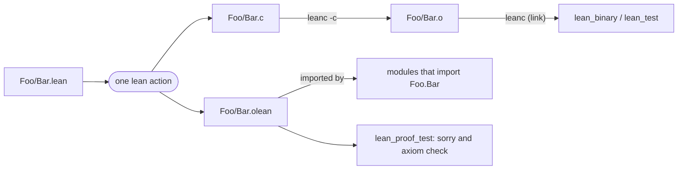
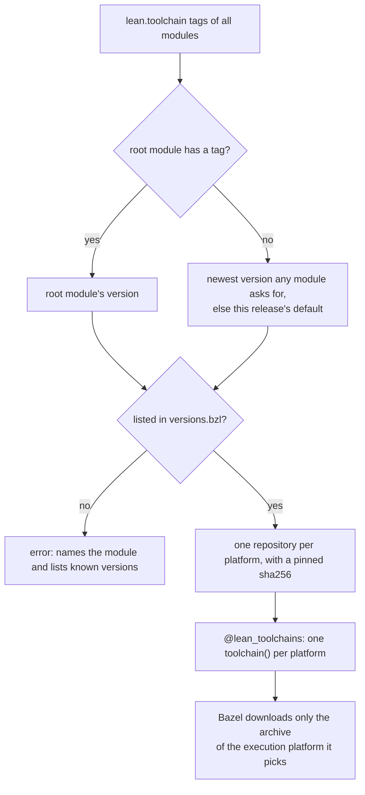

# rules_lean

[](https://github.com/martianoff/rules_lean/actions/workflows/ci.yml)

Bazel rules for [Lean 4](https://lean-lang.org): build Lean libraries, native
executables and machine-checked proofs as ordinary Bazel targets, on Linux, macOS
**and Windows**.

- **Pinned, checksummed toolchains** for five platforms, downloaded from Lean's own
  release hosts. No `elan`, no system Lean, no C compiler to install.
- **One action per module**, so Bazel caches and parallelizes at module granularity
  and rebuilds only what an edit affects.
- **Native binaries and tests** through the C toolchain bundled with Lean (`leanc`).
  No MSVC or system clang is needed, also on Windows.
- **`lean_proof_test`**: fails on `sorry` and on axioms you did not allow. Lean itself
  only warns about `sorry`, so this is what makes a proof count in CI.
- **Bzlmod only**, Bazel 7.4 or newer.

## Why

[Lake](https://github.com/leanprover/lean4/tree/master/src/lake) is Lean's own build
tool and the right choice for a Lean-only project. rules_lean is for repositories where
Lean lives next to other languages: a compiler written in Go or Rust whose semantics
are formalized in Lean, a protocol with a verified model, a library whose proofs should
gate merges. In those repositories one `bazel test //...` should build the code, run
the tests and check the proofs, with the same caching, remote execution and CI as
everything else.

## Quick start

rules_lean is published in the [GALA module registry](https://github.com/martianoff/rules-gala)
(it is not in the Bazel Central Registry yet). Add that registry ahead of the BCR in
your `.bazelrc`:

```text
# .bazelrc
common --registry=https://raw.githubusercontent.com/martianoff/rules-gala/main/
common --registry=https://bcr.bazel.build
```

```starlark
# MODULE.bazel
bazel_dep(name = "rules_lean", version = "0.1.1")

# Optional: pick the Lean version. Without it you get this release's default.
lean = use_extension("@rules_lean//lean:extensions.bzl", "lean")
lean.toolchain(version = "4.35.0")
```

rules_lean registers its toolchains itself; there is nothing else to set up.

```text
my_pkg/
├── BUILD.bazel
└── Demo/
    ├── Basic.lean    -- module Demo.Basic: definitions and theorems
    ├── Main.lean     -- module Demo.Main: `import Demo.Basic`, defines `main`
    └── Test.lean     -- module Demo.Test: `def main : IO UInt32`
```

```starlark
# my_pkg/BUILD.bazel
load("@rules_lean//lean:defs.bzl", "lean_binary", "lean_library", "lean_proof_test", "lean_test")

lean_library(
    name = "basic",
    srcs = ["Demo/Basic.lean"],
)

# Fails if any theorem in Demo.Basic uses `sorry` or a non-standard axiom.
lean_proof_test(
    name = "proofs",
    deps = [":basic"],
)

lean_library(
    name = "app",
    srcs = ["Demo/Main.lean"],
    deps = [":basic"],
)

lean_binary(
    name = "demo",
    deps = [":app"],
)

lean_library(
    name = "test_main",
    srcs = ["Demo/Test.lean"],
    deps = [":basic"],
)

lean_test(
    name = "demo_test",
    deps = [":test_main"],
)
```

```sh
bazel run //my_pkg:demo
bazel test //my_pkg/...
```

[`examples/demo`](examples/demo) is this example, and [`e2e/smoke`](e2e/smoke) uses
rules_lean from a separate module, the way a consumer does.

## How a build works



- Each module is one `lean` action. It produces the module's `.olean` (what importers
  read), `.ilean` (for editors) and C file. Each C file is compiled to an object once,
  in the library, and shared by every binary that links it.
- Imports are resolved through a generated `lean --setup` file that maps every module
  the action may import to its `.olean`. No `LEAN_PATH` search is involved, so two
  libraries can share a namespace (`Chain.Base` in one package, `Chain.Mid` in another)
  and a module defined twice is an error at analysis time. Lean's own `Init`, `Std` and
  `Lean` come from the toolchain.
- Native objects are built only when a binary or test needs them. Building a
  `lean_library` alone runs only `lean`.

## Rules

Load the rules from `@rules_lean//lean:defs.bzl`. Each release also ships the same
reference generated from the rules' docstrings (`rules_lean-<tag>.docs.tar.gz`), the
format the [Bazel Central Registry](https://registry.bazel.build) renders.

### `lean_library`

Compiles Lean 4 modules, one action per module.

| Attribute | Type | Default | Description |
|---|---|---|---|
| `srcs` | list of `.lean` labels | required | Sources, **in dependency order**: a file may import the files listed before it in `srcs`, and any module of `deps`. |
| `deps` | list of `lean_library` labels | `[]` | Libraries whose modules these sources import. Transitive: a module may import any module of any library reachable through `deps`. |
| `strip_prefix` | string | `""` | Directory, relative to the package, that module names start from. See [Module names](#module-names). |

Default outputs: the `.olean` and `.ilean` files. Output group `objects`: the native
objects. Provides [`LeanInfo`](#leaninfo).

### `lean_binary`

Links Lean modules into a native executable (`.exe` on Windows) with `leanc`.

| Attribute | Type | Default | Description |
|---|---|---|---|
| `deps` | list of `lean_library` labels | required | Libraries to link, with all their transitive deps. Exactly one module must define `main`. |
| `data` | list of labels | `[]` | Files available at run time through the binary's runfiles. |
| `linkopts` | list of strings | `[]` | Extra flags for the `leanc` link step, e.g. `["-lm"]`. |

`main` may have any of Lean's usual types: `IO Unit`, `IO UInt32`,
`List String → IO UInt32`, ...

### `lean_test`

A `lean_binary` run by `bazel test`, with the same attributes plus the common test
attributes (`size`, `timeout`, `tags`, ...). The test fails when the process exits with
a non-zero code: return one from `def main : IO UInt32`, or let `main` throw.

### `lean_proof_test`

A test that fails unless every declaration of the checked modules is free of `sorry`
and depends only on allowed axioms.

| Argument | Type | Default | Description |
|---|---|---|---|
| `deps` | list of `lean_library` labels | required | Libraries whose modules are checked. |
| `allowed_axioms` | list of strings | `["propext", "Quot.sound", "Classical.choice"]` | Axioms declarations may depend on. `[]` allows none. |
| `modules` | list of strings | every module compiled directly by `deps` | Module names to check. |
| `allow_empty` | bool | `False` | Don't fail when the checked modules declare nothing. |
| `**kwargs` | | | Common test attributes (`tags`, `size`, `visibility`, ...). `tags`, `target_compatible_with`, `exec_compatible_with`, `exec_properties`, `features`, `compatible_with` and `restricted_to` also apply to the check, so a test that is `manual` or incompatible is never checked by `bazel build //...`. |

The check is a build action, so `bazel build //...` already fails on an incomplete
proof. The error names each offending declaration and what it depends on:

```text
error: lean_proof_test: declarations depend on sorry or on axioms that are not allowed:
  cheat (Neg.Holes) depends on [sorryAx]
  usesAxiom (Neg.Holes) depends on [myAxiom]
```

[`tests/negative`](tests/negative) is a target that must fail this way; CI checks that
it does.

### `LeanInfo`

The provider `lean_library` returns, for rules that build on it.

| Field | Type | Description |
|---|---|---|
| `direct_modules` | list of string | Module names compiled by this target. |
| `module_oleans` | depset of `(string, File)` | Module name and `.olean`, transitive. |
| `oleans` | depset of File | `.olean` and `.ilean` files, transitive. |
| `objects` | depset of File | Native object of every module, transitive. |

### `lean` module extension

```starlark
lean = use_extension("@rules_lean//lean:extensions.bzl", "lean")
lean.toolchain(version = "4.35.0")
```

| Tag | Attribute | Description |
|---|---|---|
| `toolchain` | `version` (string, required) | A Lean release without the leading `v`, e.g. `"4.35.0"`. Must be a version this rules_lean release knows. |

Each module may call `lean.toolchain` at most once.

### Toolchain

Rules that run Lean themselves can use the toolchain type
`@rules_lean//lean:toolchain_type`. Its `ToolchainInfo` has `lean` and `leanc`
(executables), `lean_files` and `cc_files` (depsets of the files each needs) and
`version`.

## Toolchains and version pinning



- **One Lean version per build.** The root module decides. If it doesn't, the newest
  version requested by any dependency wins, so a library that needs a newer Lean gets
  it. If nobody asks, the release's default is used.
- **Every version is pinned.** [`lean/private/versions.bzl`](lean/private/versions.bzl)
  lists, for each known Lean release, the archive and its sha256 for each platform.
  A version that is not listed is an error; to use a newer Lean, upgrade rules_lean or
  add the version ([CONTRIBUTING.md](CONTRIBUTING.md#adding-a-lean-version)).
- **Archives come from Lean's release hosts**: `releases.lean-lang.org`, then GitHub
  releases as a fallback, verified by checksum. They are never mirrored by rules_lean.
- **Lazy download.** The toolchain hub declares all platforms without fetching
  anything; Bazel downloads only the archive of the execution platform it resolves,
  and only once a Lean target is built. An archive is 550-600 MB; keep Bazel's
  repository cache (on by default) between CI runs.

| Platform | Lean archive | CI |
|---|---|---|
| Linux x86_64 | `lean-<v>-linux.tar.zst` | `ubuntu-24.04` |
| Linux aarch64 | `lean-<v>-linux_aarch64.tar.zst` | `ubuntu-24.04-arm` |
| macOS arm64 | `lean-<v>-darwin_aarch64.tar.zst` | `macos-15` |
| macOS x86_64 | `lean-<v>-darwin.tar.zst` | `macos-15-intel` |
| Windows x86_64 | `lean-<v>-windows.tar.zst` | `windows-2025` |

CI runs every platform with Bazel 7.4.1 (the oldest supported), the latest 8.x and the
latest 9.x.

## Module names

A module's name is its path below the *module root* with `/` replaced by `.` and
`.lean` removed. The module root is the package directory, or `strip_prefix` below it:

| Package | `strip_prefix` | Source | Module |
|---|---|---|---|
| `//proofs` | | `proofs/Gala/Eval.lean` | `Gala.Eval` |
| `//proofs` | `"src"` | `proofs/src/Gala/Eval.lean` | `Gala.Eval` |
| `//` (root) | | `Gala/Eval.lean` | `Gala.Eval` |

So put the `BUILD.bazel` file at the directory a module's name starts from, or use
`strip_prefix` to point there. A source outside the module root is an error. Module
names must be unique across a target and everything it depends on.

## Windows

Windows is a first-class platform: CI runs every test on `windows-2025`.

- Nothing to install besides Bazel (through Bazelisk). Lean's Windows release bundles
  clang and lld, which `leanc` uses to compile and link; MSVC is not needed.
- `lean_binary` produces `name.exe`.
- Keep the output root short if you hit path-length errors, e.g.
  `startup --output_user_root=C:/_b` in your `.bazelrc`.
- In Git Bash, set `MSYS_NO_PATHCONV=1` so that `//pkg:target` labels are not
  rewritten as paths.

## Limitations

- **No Lean module system yet.** Files that start with `module` (and use
  `public import`, `meta import`, ...) need `.olean.server`, `.olean.private` and `.ir`
  artifacts that rules_lean does not produce yet. Ordinary Lean files work.
- **No Lake packages, so no Mathlib yet.** Dependencies must be `lean_library`
  targets; rules_lean does not read `lakefile.lean` / `lakefile.toml` or fetch Lake
  packages.
- **`srcs` order matters** within one `lean_library`: a module can import only modules
  listed before it. Split a target or reorder `srcs` if a build reports an unknown
  module.
- **No cross-compilation.** Lean runs, and binaries are built, for the execution
  platform.
- **No C/FFI sources** (`@[extern]` implementations in C) and no shared libraries or
  Lean plugins.
- **No editor integration.** Use Lake or `lean --server` with your editor; rules_lean
  is for builds and CI.

## Contributing

See [CONTRIBUTING.md](CONTRIBUTING.md): running the tests, adding a Lean version,
releasing.

## Licensing

rules_lean is Apache 2.0. Lean 4 is Apache 2.0; its release archives also bundle
LLVM (Apache 2.0 with LLVM exceptions), CaDiCaL (MIT) and LGPL components (GNU MP,
and glibc on Linux). rules_lean never re-hosts those archives: toolchains are fetched
from Lean's own release hosts and verified by checksum, and rules_lean's releases
contain only its own sources. Binaries you build with `lean_binary` link Lean's
runtime; check those terms before distributing them.
